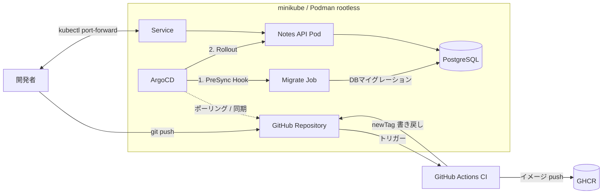

# dotnet-lab

.NET 10、Kubernetes（minikube）、ArgoCDを用いたクラウドネイティブ開発およびGitOpsの実践・検証リポジトリです。

## 作成の目的と背景
インフラエンジニアが構築したCI/CDパイプラインの保守・運用経験を土台に、**「Argo CDを用いたGitOpsデプロイ環境の仕組みをゼロから体系的に理解すること」**を目的として検証環境を構築しました。

### 開発プロセスとAI活用について
設計・実装・ドキュメント作成の大部分をAIエージェントとの協業により進めています。AIをパートナーとして活用しつつ、実際の挙動や実運用での課題を検証・言語化することに重きを置いています。

## ドキュメント一覧
* **[LEARNING.md](./LEARNING.md)** — 検証過程での制約、トラブルシューティング、運用ナレッジ集
* **[TASKS.md](./TASKS.md)** — API仕様、フェーズ別の構築記録および設計判断の根拠

## アーキテクチャ概要

`git push` によるGitHub Actions経由のイメージビルドとマニフェスト更新、ArgoCDによる自動同期（PreSyncでのEF Coreマイグレーション実行）を行う構成をとっています。詳細はリポジトリ内の図や設定をご参照ください。

### 主要技術スタック
* **Backend:** .NET 10 (Minimal APIs), Entity Framework Core, Scalar (OpenAPI)
* **Database:** PostgreSQL 17
* **Container / Orchestration:** Podman (rootless), minikube, Kubernetes, Kustomize
* **CI/CD & GitOps:** GitHub Actions, GHCR, ArgoCD

## 検証を通じて得た知見・こだわり
1. **運用者視点での「ハマりどころ」の言語化** — `selfHeal` の挙動や `Synced` と `Succeeded` の違いなど、実運用で直面しやすいポイントを [LEARNING.md](./LEARNING.md) にまとめています。
2. **GitOpsの自動化と無限ループ防止** — マニフェスト書き戻し時のCI再発火を防止する制御を検証。
3. **安全なDBマイグレーション** — ArgoCDの `PreSync` フックを活用したフローを検証。

## クイックスタート
詳細な手順や確認コマンドは [LEARNING.md](./LEARNING.md) をご参照ください。
